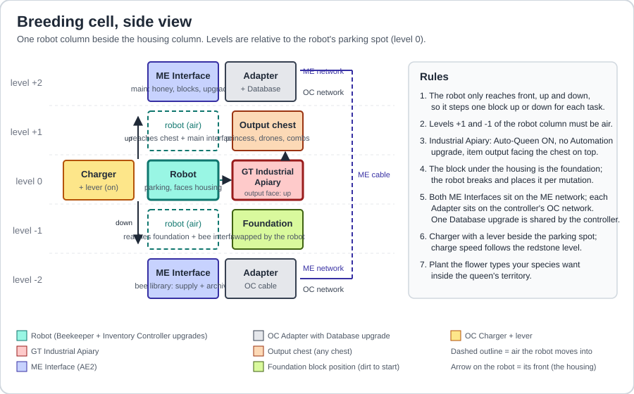
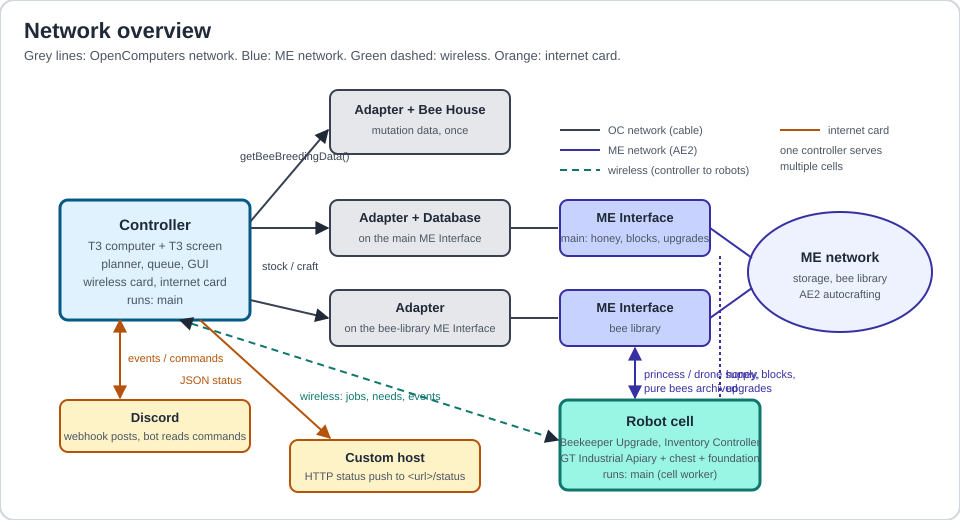

# GTNH-Auto-Bees


GTNH-Auto-Bees automates Forestry bee breeding in GregTech: New Horizons using an OpenComputers
controller and robots. The controller reads your pack's mutation data and plans a route from the drones
in your AE2 network. The robots run the jobs, analyze offspring, and return bees to ME storage.

> [!CAUTION]
> Alpha. The simulator exercises the breeding workflow. Live GTNH operation still needs verification.
> The setup below uses the GT Industrial Apiary and the ME Interface slot convention for GTNH 2.8 and 2.9.

## Content

- [Information](#information)
- [Installation](#installation)
- [Setup](#setup)
- [First breeding run](#first-breeding-run)
- [Configuration](#configuration)
- [Development](#development)
- [Status](#status)
- [Credits](#credits)

<a id="information"></a>

## Information

The program has two roles that share one install:

- **Controller** (a computer with a screen): reads the mutation graph out of the game, numbers every species,
  plans chains, keeps a job queue, serves the robots from the ME network, draws the GUI and talks to Discord.
- **Cell** (a robot next to a housing): breeds one job at a time. Fetch a princess and drones from the library,
  set the foundation and climate, run generations, analyze offspring, purify, stockpile, archive.

What it does:

- **Numbered catalog.** Every species gets a stable number on the first survey: `1xxx` Forestry, `2xxx` Extra Bees,
  `3xxx` Magic Bees, `4xxx` GregTech. `breed 4137` is all you type.
- **Mutation planning.** The controller surveys a Forestry housing through an Adapter. It uses species IDs
  and parent data when available, with a fallback to the bulk breeding data. `plan` shows the route it can
  build from your stock, and `routes` shows the available mutations and their conditions.
- **Requirements handled by robots.** Foundation blocks are swapped under the housing, Industrial Apiary climate
  upgrades (heater, cooler, humidifier, dryer, Hell emulation) are installed per mutation, offspring are analyzed
  in the robot's own inventory. No Mutatron anywhere.
- **Purification and stockpiling.** The robot analyzes offspring and breeds the target back to species purity.
  It banks surplus drones in the bee-library interface. By default it returns rejected bees through the main
  interface, so those bees can also appear in ME storage.
- **Extras on the way.** `breed 4137 extra 4051=64 4060=32` keeps 64 and 32 drones of two intermediates,
  `all 16` keeps 16 of every intermediate. Intermediates are stockpiled in proportion to how unlikely the next
  mutation is. The controller can queue a restock when a job runs out of a parent line that can multiply.
- **Needs lists.** Per request and for the whole game: which foundation blocks are stocked, craftable, or missing a
  pattern, plus the climate upgrades the route calls for.
- **Monitoring.** The controller shows the queue, cells, and log. Optional integrations include Discord
  events and commands, and JSON status sent to a custom host.

#### Controls

<kbd>End</kbd> - Closing the program

<kbd>Arrow Up</kbd> / <kbd>Arrow Down</kbd> - Scroll the log

<kbd>Page Up</kbd> / <kbd>Page Down</kbd> - Scroll the queue

Type a command and press <kbd>Enter</kbd>. The same words work in Discord with the `!` prefix.

#### Interface

| Command | Effect |
|---|---|
| `breed 4137` | queue the species with its whole chain, default 8 drones + a princess |
| `breed 4137 keep 32` | 32 drones of the target |
| `breed 4137 extra 4051=64 4060=32` | also stockpile intermediates |
| `breed 4137 all 16` | keep 16 drones of every intermediate |
| `plan 4137` | show the steps, chances and conditions the planner picked |
| `routes 1005 [all]` | every mutation that makes a species, best odds first, marking the one the planner picked |
| `improve 2078 want 2` | breed a better fertility allele onto a species, using a donor from the library |
| `purify 1005 keep 8` | breed a species with itself until its drones stack, holding out rather than settling |
| `needs 4137` | foundation blocks and climate upgrades for the route, with foundation stock status |
| `find naquadah` | catalog numbers |
| `status`, `queue`, `cells`, `library [text]` | what is happening |
| `cancel j12` / `cancel r3` | stop a job or a whole request |
| `more 1005 keep 64` / `more 1005 keep forever` | just make more of a bee you already have |
| `keep j12 64` / `keep r3 forever` | change what a queued or running job is working towards |
| `scan`, `survey` | rescan the ME library, re-read the mutation graph |
| `retry <job or request ID>` | return failed jobs to the queue after fixing the cause |
| `pair` | mark each ME interface in turn and ask the robot which one it can reach, then save the answer |
| `diag` | report what the robot can reach above, below and in front of itself |
| `settings` | show connection settings; `settings test` probes them; `settings discord webhook <url>`, `settings discord bot <token> <channel>`, `settings host <url>` change them |

<a id="installation"></a>

## Installation

> [!CAUTION]
> Online installation needs an Internet Card on each machine while it runs the installer. The controller
> also needs the card for Discord or a custom host. Use the manual copy method below if HTTPS downloads fail.

To run the controller you need a computer with:

| Item | Count | Notes |
|---|---|---|
| Computer Case T3 | 1 | T2 works for a single cell; T3 leaves room for more cells and cards |
| CPU T3 | 1 | component limit 16; a Server Rack with Component Buses past about 6 cells |
| Memory T3.5 | 2 | the planner holds the whole mutation graph in RAM |
| Hard Disk T2 or T3 | 1 | OpenOS + data |
| EEPROM (Lua BIOS) | 1 | |
| Graphics Card T3 | 1 | |
| Screen T3 | 1+ | the controller GUI uses 120 columns |
| Keyboard | 1 | |
| Wireless Network Card T2 | 1 | or wired OC cable to every robot |
| Internet Card | 1 | installer, Discord, host link |
| Disk Drive + OpenOS floppy | 1 | to install the OS once |
| OC Power Converter or Charger power | 1 | any EU/RF source |

Each cell needs a robot assembled in the Electronics Assembler with:

| Item | Count | Notes |
|---|---|---|
| Computer Case T2 (T3 recommended) | 1 | T2 has 3 tier-2 + 3 tier-1 upgrade slots, T3 has 3+3+3 |
| CPU T2 | 1 | |
| Memory T2 | 2 | |
| Hard Disk T1 | 1 | with OpenOS installed |
| EEPROM (Lua BIOS) | 1 | |
| Beekeeper Upgrade | 1 | GTNH-only OpenComputers item, tier 2 slot |
| Inventory Controller Upgrade | 1 | tier 2 slot |
| Inventory Upgrade | 2 | 16 slots each; 32 working slots keeps big generations comfortable |
| Wireless Network Card T2 | 1 | |
| Graphics Card T1 + Screen T1 + Keyboard | 1 each | console for the first-run guide and troubleshooting |
| Internet Card | 1 | needed on the robot for online installation |
| Disk Drive | 1 | optional, to install OpenOS from a floppy directly on the robot |
| Pick (tool slot) | 1 | foundation swaps wear it; a self-repairing or high-durability pick |
| OC Charger + lever | 1 | next to the robot's parking spot; charge speed follows the redstone level |

Install OpenOS to the hard disk on both machines. Use the **Lua 5.3** architecture on both CPUs because the
bundled libraries use Lua 5.3 syntax. Build and cable the [cell and survey housing](#setup) before running
the first-start guide.

On each machine, download and run the installer from `/home`:

```shell
cd /home
wget -f https://raw.githubusercontent.com/dronf/GTNH-Auto-Bees/main/installer.lua installer.lua
installer
```

The installer tries the fork's latest release archive first and fetches the files from `main` if the
archive is unavailable. It preserves an existing `config.lua` and offers to add `main` to the boot flow
by writing `/home/.shrc`.

For a manual install, transfer `main.lua`, `config.lua`, `version.lua`, and the entire `src/` and `lib/`
directories to `/home` on each OpenOS hard disk. Keep the directory structure and save any existing
`config.lua` before copying. Run this from `/home` on the controller and then on the parked robot:

```shell
main
```

> [!NOTE]
> The controller guide asks for a cell name, housing, the two Interface addresses, local temperature and
> humidity, and optional Discord and host settings. The robot guide asks for its matching cell name and
> housing. Both write their answers to `/home/settings.dat`. Run `main setup` to revisit the guide.

<a id="setup"></a>

## Setup

> [!NOTE]
> For easy copying of addresses, use the Analyzer from the OpenComputers mod. Right-click a component and its
> address is written to chat; click it to copy.

### Data source

#### Components

- Bee House (Forestry): 1
- Adapter: 1

#### Description

Place an OpenComputers Adapter against a Forestry Bee House and cable it to the controller. Leave this
connection available for the first-start survey and future `survey` commands.

> [!CAUTION]
> The GT Industrial Apiary does not expose this component. You need a Forestry housing for the data even if you
> breed in GT machines.

### Breeding cell

#### Components

- GT Industrial Apiary: 1
- Chest: 1
- ME Interface: 2
- Adapter: 2
- Database Upgrade T1: 1 shared by the controller, installed in one of the cabled Adapters
- Robot (see the parts table above): 1
- Charger + lever: 1
- Powered AE2 network with available storage, ME cable and a channel for each Interface
- OC cable from both Interface Adapters to the controller
- EU supply for the Industrial Apiary, sized for its chosen acceleration

#### Layout



The robot parks at level 0 facing the housing and only ever moves straight up or down inside its column. Level +1
gives it the output chest (front) and the main ME Interface (up); level -1 gives it the foundation position
(front) and the bee-library ME Interface (down). Keep both column blocks free. Start the robot parked at
level 0 facing the apiary. Use matching modem ports on the controller and robot (`7311` by default).

Use two dedicated Interface blocks on the same powered ME network. Leave their stocking configurations empty
so the controller can manage them. By default the main Interface uses slots 1 for honey, 2 for supplies, and
9 for returns. The bee-library Interface uses slots 1 for princesses, 2 for drones, and 9 for archiving.
Both Interfaces need free capacity to accept items back into ME.

#### Industrial Apiary settings

- **Auto-Queen ON.** The machine only moves a freshly mated queen back into the slot; the returned princess still
  goes to the chest, which is what the robot expects.
- **No Automation upgrade.** It re-mates the returned princess with whatever drone is left and destroys controlled
  pairing.
- Enable item auto-output and point the item output face up into the chest. Start with an empty chest and
  empty bee input slots.
- If you use speed or lifespan upgrades, leave room for the climate upgrades the job requires. Set speed to
  match your power supply.
- Place dirt under the machine as a starting foundation. Equip a pick that can break the blocks you plan
  to use.
- Place the flowers needed by the breeding lines within the queen's territory. Pick a line suited to the
  cell's climate, light and weather for your first run.

#### Climate upgrade pool

Shared by every cell through the ME network, installed per job:

| Item | Count | Notes |
|---|---|---|
| Heater upgrade | 16 | +0.125 temperature each (GTApiaryUpgrade) |
| Cooler upgrade | 16 | -0.125 temperature each |
| Humidifier upgrade | 16 | +0.125 humidity each |
| Dryer upgrade | 16 | -0.125 humidity each |
| Hell emulation upgrade | 1 | for Hellish temperature requirements |

#### Consumables

| Item | Rate | Source |
|---|---|---|
| Honey Drop | 1 per analysis | keep a stack or more in ME; the controller stocks main Interface slot 1 |
| Foundation blocks | 1 per distinct block, reusable | AE2 patterns; the survey writes the full list to `needs_global.txt` |
| Pick durability | 1 per foundation swap | |
| EU | HV plus whatever the speed upgrade adds | |

### Network overview



One controller serves multiple cells within its component limit. The robots talk to it over the modem.
Connect each cell's Adapters to the controller's OC network and each Interface to the powered ME network.

## First breeding run

1. **Stock ME.** Add Honey Drops, a Forestry princess, and a stack of drones from the same species. For a
   stockpile test, use an analyzed, species-pure line with fertility 2 or higher. Keep the flowers it uses
   within reach of the apiary. For a mutation, also stock drones for both parents and any foundation blocks
   or climate upgrades the route requires.
2. **Start both machines.** Run `main` on the controller and complete the guide. Choose the upper Interface
   as main and the lower Interface as bee library. Select `gt_iapiary` and the cell's local climate. The
   controller surveys the Bee House on first start. Run `main` on the parked robot with the same cell name
   and housing.
3. **Check the connection.** Run `cells` on the controller and confirm the robot appears idle. With Honey
   Drops in ME, run `pair cell1` (substitute your cell name). Wait for pairing to finish, then run `scan`
   and `library` to check that the controller sees the starter bees.
4. **Queue a small job.** Run `find <species name>` and note the catalog ID. Run `more <ID> keep 2` for
   the stockpile test. To try a mutation, run `plan <target ID>` and `needs <target ID>` first, then
   `breed <target ID> keep 2`.
5. **Check the result.** Watch the queue and cell status. After the job completes, run `scan` and
   `library <species name>` to verify that bees reached ME storage. If a job stalls, use the log to find
   the missing item or machine condition. Use `diag` with the robot idle to check reach, and
   `retry <job ID>` after correcting a failed job's cause.

### Reading the timestamps

OpenComputers stamps its logs with the in-game clock, which runs 72 times faster than real time. An hour on
screen is fifty real seconds, so a log that looks like it spent an hour on one step spent under a minute.

### A species is available only when you have drones of it

Every mating spends a drone, so the planner counts a species as owned only when the library holds drones of it.
Princesses alone do not make a route usable, which is why a chain can reach for a species you would not expect
while ignoring one you are sure you have. `library <name>` splits the unanalyzed count into drones and
princesses, and `routes` shows the drone count for both parents of every route.

### Making more of what you have

`breed` on a species already in the library queues a stockpile run rather than a mutation, and `more` says the
same thing plainly: `more 1005 keep 64`. With `keep forever` the run has no target and breeds until you cancel
it, which also means it holds that cell, so give it one of its own if you have several. A line at fertility 1
cannot make more of itself and is refused with a pointer at `improve`.

### Upgrades you installed yourself

For a mutation with a temperature or humidity requirement, the robot adjusts that part of the installed
climate to match the controller's plan, including removing surplus upgrades. Jobs without a climate
requirement leave the installed climate alone.

If a cell always carries a climate upgrade, declare it in that cell's configuration, for example
`fixedUpgrades = { dryer = 2 }`. The planner includes those upgrades in the baseline for the cell.

### More than one cell

Each cell declares its local temperature and humidity. The controller prefers the compatible idle cell
that needs the fewest climate upgrades. A job stays queued while no compatible cell is available.

Adding a cell:

1. Build it like the first one. Cable both of its Adapters to the controller's OC network and put both ME
   Interfaces on the library's ME network. The controller stocks every interface through a single Database
   upgrade, so the Adapters of later cells can go without one.
2. On the controller: `cell add cell2 plains`. `cell add` alone lists the biome names; `cell add cell2 1.2 0.1`
   takes the temperature and humidity as numbers.
3. Install on the new robot and run `main`. The guide asks for the cell name: give the same one, `cell2`.
4. When `cells` shows it, run `pair cell2` on the controller with that robot idle.

A cell gets no jobs until its interfaces are known, and `cells` says what is missing. A robot whose name is not
in the config borrows the settings of the one configured cell only while it is the only robot online, so a
second robot never works out of the first cell's interfaces. Once there are two, give each robot its own entry
with `cell add` and `pair`, or rename the robot with `main setup` on it. `cell` lists every cell with its climate and
whether it is paired; `cell remove <name>` takes one out.

Every ME Interface an Adapter exposes and every Database upgrade counts towards the computer's component limit
(16 with a tier 3 CPU). A few cells in, the controller wants a server with component buses.

### When a queen will not work

A queen that refuses to work is nearly always missing her flowers, the right temperature, the right air, or
somewhere to put what she makes. The robot compares her genome against the cell's biome and the machine's slots
and logs possible causes. Check the actual machine error display, the installed upgrades, the flowers
and power. Automatic climate changes follow the mutation's parsed requirements. A stockpile job uses the
cell's existing climate.

### Pristine before ignoble

Wild stock is pristine and bred stock can be ignoble, and ignoble bees risk being lost when they breed in an
alveary. A pristine bee therefore wins a tie: it scores higher when a mate or a spare is chosen, and when a run
will take any princess at all, a species with pristine princesses is handed over ahead of one with more but
ignoble. Nothing refuses ignoble stock, which breeds exactly as well and is the right thing to spend.
`library` shows the pristine count beside the princesses.

### Better bees win

Between two mates of the same species, the better genetics are chosen: faster production, higher fertility,
working at night, in the rain and underground, and a beneficial effect over a harmful one. Shorter lives count
in favour too, since a shorter cycle means a quicker generation. The weights sit in `genome.traitWeights`.
`purify <species>` breeds a species with itself for that reason alone, holding out until its drones stack
instead of settling for species purity.

### Finished means the drones stack

The breeder prefers species-pure drones with matching alleles on each chromosome. Ordinary jobs can
accept species-pure drones with differing alleles once the generation threshold is reached (60 by
default). Use `purify` to keep trying for matching alleles up to the job's generation limit.

### Lucky bees are kept

A princess carrying the target mated with a parent drone can mutate into the step *after* the one being bred, so
chasing Common turns up the occasional Cultivated. Any bee that is pure of any species goes to the library,
whatever the job was for, and the log says what turned up.

By default `keepJunk = true` sends rejected bees back to ME through the main Interface. Because AE2 stocks
bees by label, a hybrid can show up on a later fetch. The robot checks the genome after fetching and can
try another stack. Keep the shared network clear of unwanted same-label stock if fetches repeatedly fail.

### Odds are weighed against your stock

The planner estimates the chance of a hit before the available parent drones run out as `1 - (1 - p)^n`. One drone at 30% is a single attempt and usually fails; Forest
and Meadows in quantity at 15% is a near certainty. The planner scores routes that way, so it prefers the one
your library can actually finish, and `routes` prints the arithmetic per route. A line that cannot breed more of
itself is capped at what you hold; a stockpilable one is credited with what it could breed, minus a little for
the time that takes. `stockWeight` in `config.lua` sets how hard this pulls.

### Why it picked those parents

The mutation list is read out of your own game with `getBeeParents`, so it holds whatever your pack defines,
including routes the mods add beyond the Forestry ones. Where several routes make the same bee, the planner
picks by cost: better odds are cheaper, a required foundation block or climate costs extra, and a species you
already own costs nothing to obtain. `routes 1005` prints them all and marks the one it chose.

### Restocking parent drones

The controller uses `droneFloor` (4 by default) to decide when to request a parent top-up. The library can
still run out, especially if multiple jobs share the same drones or a line cannot multiply. Check `library`
and add stock if a job is waiting for parents.

### Fertility 1 lines cannot be stockpiled

A queen makes as many drones per cycle as her fertility allele, and mating spends one of them, so a line with
fertility 1 breaks even forever: it can never grow its own stock. Such a line is still good for the rest of
breeding, where a princess is given the drones' species and the hybrids are binned, so only stockpiling is
refused. `library` prints the fertility it has seen for each species and marks the ones that cannot stockpile.
Supply those drones from wild hives, or lift the line itself with `improve`.

Fertility is an allele of its own, inherited independently of the species, so a bee that comes out of the hives
at fertility 1 can be lifted. `improve 2078` picks a donor from the library that already has the better allele,
crosses it in, then breeds the species back to pure while keeping the bees that carry the allele twice. A bee
shows both of its alleles once analyzed, so "breeds true" is checked rather than assumed. When it finishes, the
species is stockpilable and the mark is cleared automatically.

### Why it breeds a parent species first

A step with a 15% chance takes about seven attempts on average. The controller can queue a stockpile
job when the library is short of a parent that can multiply. That job mates the
species with itself until it has banked enough drones. The `cells` line shows how far along it is, as
`archived 4/11`. If the count sits still for many generations the log says so.

### When drones are bred but never stored

Each generation hands its surplus drones to the ME interface below the robot. If that interface takes nothing,
the drones stay in the robot and the run makes no progress however long it goes. The robot tries every free
slot, says which one it used, and after three failed handovers the job stops with `the bee interface would not
take the drones`. Check that the interface is on the ME network, has a channel, and is not full.

### Honey drops are not optional

Analysis uses one Honey Drop per unanalyzed stack. Keep Honey Drops in ME and check the count with
`library`. If a job reports `analysis needs Honey Drop`, replenish the supply so the controller can
resume it.

### When a fetch never arrives

The robot waits at an ME Interface slot that the network is supposed to fill. If the log says a slot stayed
empty, run `pair` on the controller with the robot idle. It stocks two honey drops into each interface in turn
and asks the robot which one it can see, then saves the addresses itself.

Both interfaces being on the same ME network does not make them interchangeable. Each is a separate block with
its own nine slots, and the robot can only reach the one it stands next to, so the addresses have to match the
blocks. `pair` reports which of these is wrong:

| Report | Meaning |
| :---- | :---- |
| `bee interface corrected to ...` | the addresses were swapped and are now saved the right way round |
| `nothing with an inventory below the robot` | the bee interface is missing or the column is off by one block |
| `an inventory sits below the robot but the network never put the marker in it` | no Adapter touches that interface, it is on another ME network, or it has no channel or power |
| `did not answer the probe` | the robot is not running `main` |

`diag` is the smaller version: it reports what the robot can reach above, below and in front without touching
the ME network at all. An ME Interface reports nine slots, the apiary more, air reports none.

`pair` also measures the slot numbering. On GTNH 2.8 and 2.9, ME Interface configuration slots and inventory
reads both count from one, so the `interfaceSlotOffset` setting defaults to 0. `pair` corrects it if a build
differs.

<a id="configuration"></a>

## Configuration

General configuration lives in `config.lua`. The setup guide writes its answers to `settings.dat`, which is merged
over the `controller` and `cell` sections at start, so `config.lua` stays a readable template.

#### Controller part

```lua
controller = {
  dataDir = "/home/data",            -- graph.dat, catalog.dat, state.dat, catalog.txt, needs_global.txt
  port = 7311,                       -- wireless / wired port shared with the robots
  ae2 = { network = nil, database = nil }, -- ME network component and Database upgrade, nil = first found
  cells = {
    cell1 = {
      housing = "gt_iapiary",
      mainInterface = "aaaaaaaa-aaaa-aaaa-aaaa-aaaaaaaaaaaa", -- interface above the robot column
      beeInterface = "bbbbbbbb-bbbb-bbbb-bbbb-bbbbbbbbbbbb",  -- interface below the robot column
      base = { temp = 0.8, hum = 0.4 },                       -- biome values where the cell stands
    },
  },
  defaults = { keepDrones = 8, droneFloor = 4, droneSupply = 16, maxGenerations = 400, warnAfter = 60 },
},
```

#### Cell part

Used when `main` runs on a robot. `name` must match a key in `controller.cells`.

```lua
cell = {
  name = "cell1",
  port = 7311,
  housing = "gt_iapiary",            -- matches the controller's housing for this cell
  slots = { honey = 1, scratch = 2, firstWork = 3 },
  keepJunk = true,
  startTimeout = 45,
  cycleTimeout = 2400,               -- seconds allowed for a queen's cycle
  requestTimeout = 90,
  keepUpgrades = { speed = true, lifespan = true }, -- never evicted to make room for climate upgrades
},
```

#### Logger part

Same logger as the reference programs: a Discord webhook for warnings, a file, and the scrolling list on screen.

```lua
logger = loggerLib:newFormConfig({
  name = "Auto Bees",
  timeZone = 0,
  handlers = {
    discordLoggerHandler:newFormConfig({ logLevel = "warning", messageFormat = "{Time:%d.%m.%Y %H:%M:%S} [{LogLevel}]: {Message}", discordWebhookUrl = "" }),
    fileLoggerHandler:newFormConfig({ logLevel = "debug", messageFormat = "{Time:%d.%m.%Y %H:%M:%S} [{LogLevel}]: {Message}", filePath = "logs.log" }),
    scrollListLoggerHandler:newFormConfig({ logLevel = "info", logsListSize = 64 }),
  }
}),
```

#### Discord

Discord is optional. Connect the controller's Internet Card before using any of these modes:

| Mode | You provide | You get |
|---|---|---|
| Webhook | a webhook URL | colour-coded event cards (job started, phase reached, done, failed, needs you), a status card that is replaced whenever a job starts or ends, the logger's warnings |
| Bot, no hosting | a bot token and a channel id | all of the above plus `!commands` typed in the channel; the computer polls the channel every few seconds |
| Relay | `relay/bot.py` running on a machine of yours, plus the bot token | a main card with buttons (Status, Queue, Cells, Library, Find, Plan, Needs, Breed, Cancel, Rescan) and a `/bee` slash command; see [relay/README.md](relay/README.md) |

Species are identified by their allele uid, not by name. Where two mods use the same name (Diamond, Ruby, Lapis,
Emerald, Certus, Fluix, Sapphire, Water and a few more) every label carries the mod, for example
`[4060] Diamond (GregTech)` and `[2033] Diamond (Extra Bees)`, `find diamond` lists both, and `breed` asks for the
number when a bare name is shared.

Species cards can show icons from `docs/bees/`. The icons are
regenerated from your modpack's jars with `python tools/bee_images.py`. In bot mode every command works from the
channel: `!find naqua`, `!plan 4137`, `!needs 4137`, `!breed 4137 keep 16`, `!library`, `!status`, `!settings` and the
rest. Species-centred replies come back as embeds with the icon, everything else as a code block.

[How to create a Discord webhook](https://www.svix.com/resources/guides/how-to-make-webhook-discord/). Enter it in
the setup guide or with `settings discord webhook <url>` on the controller; it is stored in `settings.dat`, never in
`config.lua`. For commands, create an application in the Discord developer portal, add a bot, invite it with
*View Channel*, *Send Messages*, *Embed Links*, and *Read Message History*, then run
`settings discord bot <token> <channel id>`.

```lua
discord = {
  enabled = false,
  webhook = "",         -- webhook URL (the guide or `settings discord webhook <url>` fills this)
  token = "",           -- bot token (optional, for commands)
  channel = "",         -- channel id (optional, for commands)
  pollInterval = 5,     -- seconds between command polls (bot mode)
  prefix = "!",
  statusCard = true,    -- keep one status message that is replaced on job start/end
  statusInterval = 0,   -- also refresh the status card every N seconds, 0 = only on events
},
```

The GTNH OpenComputers config allows HTTP with custom headers by default; the setup guide tells you if a server has
turned it off.

#### Custom host

Optional. When `host.url` is set the controller pushes a JSON status document to `<url>/status` every
`host.pushInterval` seconds, so a page of your own can show the queue and the cells. `settings test host` probes
the URL and reports the HTTP code and round trip time; the setup guide offers the same test.

```lua
host = {
  url = "",            -- e.g. http://192.168.1.10:8080
  pushInterval = 30,   -- seconds, 0 = never push
  relay = false,       -- for a host that only accepts status; use true for the Discord relay
},
```

<a id="development"></a>

## Development

The pure-logic modules run under a real Lua 5.2 on a PC:

```shell
pip install lupa
python test/run_tests.py
```

The suite includes a small Forestry-like genetics simulator that drives the breeding state machine through convert,
mutate, purify and stockpile, and a stress run across many seeds and mutation chances. Nothing in `test/` ships in
the release archive.

Repository layout:

```
main.lua               entry point: controller GUI on a computer, cell worker on a robot
config.lua             configuration template
version.lua            programVersion / configVersion for auto update
installer.lua          installs from a release archive or the main branch into /home
lib/                   vendored MIT libraries: program, gui, logger, state machine, discovery
src/graph.lua          mutation graph and planner (hyper-edge shortest path)
src/breeder.lua        per-job breeding state machine, hardware independent
src/controller.lua     planner, queue, dispatch, commands, Discord
src/cell.lua           robot worker
src/survey.lua         first run: graph, catalog, condition check, global needs list
src/setup.lua          first-boot guide
src/settings.lua       settings.dat handling
src/conditions.lua     parses "Requires X as a foundation." and friends
src/climate.lua        Forestry climate math for Industrial Apiary upgrades
src/catalog.lua        stable species numbering
src/genome.lua         helpers over OpenComputers bee item stacks
src/ae2.lua            ME network: library scan, crafting, stocking interfaces
src/net.lua            controller <-> robot messages
src/discord.lua        Discord REST over the internet card
src/http.lua           HTTP helper for the internet card
src/connect.lua        connection tests (webhook, bot, host) and the JSON status push
src/needs.lua          needs lists
test/                  Lua 5.2 tests and the breeding simulator
```

<a id="status"></a>

## Status

The simulator covers job dispatch, bee genetics and the ME inventory workflow. In game, verify the robot
can access both Interfaces and the Industrial Apiary, the apiary returns offspring to the output chest,
and the controller recognizes the upgrade labels in your pack.

<a id="credits"></a>

## Credits

- `lib/` contains the MIT-licensed program, GUI, logger, state machine and discovery libraries by
  [Navatusein](https://github.com/Navatusein/GTNH-OC-Libraries) (GUI library originally by CAHCAHbl4), vendored
  unchanged. The repository layout, installer flow and release workflow follow the same author's programs.
- Built on the GTNH forks of OpenComputers (Beekeeper Upgrade), Forestry and GT5-Unofficial, with the GTNH wiki's
  bee pages as the reference for game rules.
